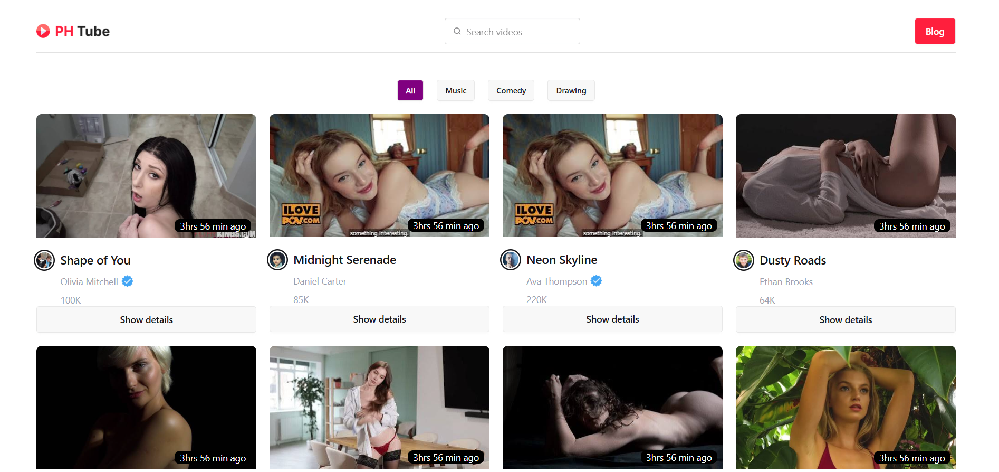

# 🎬 phTube

A lightweight, responsive video-browsing web app inspired by YouTube. Browse videos by category, search by title, and view video details in a pop-up modal, all built with vanilla JavaScript.

---

## ✨ Features

- 📂 **Dynamic Categories**: category buttons are generated from API data
- 🎞️ **Video Grid**: responsive cards showing thumbnail, title, author, and views
- ✅ **Verified Badge**: blue tick shown next to verified authors
- 🔎 **Live Search**: filter videos by title as you type
- 🗂️ **Category Filter**: click a category to see only its videos
- 🟣 **Active Button Highlight**: the selected category stays highlighted
- 📄 **Details Modal**: click "Show details" to see the full description
- 🚫 **Empty State**: a friendly message and icon when no videos are found
- 📱 **Responsive Design**: 2 columns on mobile, 4 columns on large screens

---

## 🛠️ Tech Stack

| Technology | Purpose |
|------------|---------|
| 🌐 HTML5 | Page structure |
| 🎨 Tailwind CSS v4 (CDN) | Utility-first styling |
| 🌼 DaisyUI 5 (CDN) | UI components (cards, buttons, modal, avatar) |
| ⚡ JavaScript (ES6) | Logic and DOM manipulation |
| 🔗 Fetch API | Loading data from JSONBin |
| 🗃️ JSONBin.io | Mock REST API for categories and videos |

---
## 📸 Screenshots


---
## 📁 Project Structure

```
phTube/
├── 📂 demo/
│   ├── 🖼️ demo1.png
│   ├── 🖼️ demo2.png
│   └── 🖼️ demo3.png
├── 📂 resources/
│   ├── 🖼️ Icon.png
│   └── 🖼️ Logo.png
├── 📂 script/
│   └── 📜 index.js
├── 📄 index.html
├── ⚙️ tailwind.config.js
└── 📘 README.md
```

---

## 🚀 Getting Started

1. 📥 **Clone the repository**
   ```bash
   git clone https://github.com/iseyamin/phTube.git
   ```
2. 📂 **Open the project folder**
   ```bash
   cd phTube
   ```
3. ▶️ **Run it**: open `index.html` in your browser (or use the VS Code *Live Server* extension).

> 🌍 An internet connection is required for the CDN libraries and the API.

---

## ⚙️ How It Works

| Function | Description |
|----------|-------------|
| `loadCatagories()` | 📡 Fetches categories from the API |
| `displayCatagories()` | 🔘 Creates a button for each category |
| `loadVideos()` | 📡 Fetches all videos |
| `displayVideos()` | 🃏 Renders video cards into the grid |
| `loadCatagoriesVideos(id)` | 🗂️ Loads videos for the selected category |
| `catVideo()` | 🧹 Filters videos by `category_id` |
| `removeactive()` | 🔄 Clears the active state from all buttons |
| `showdetails(id)` | 📄 Opens the modal with video details |
| `searchVideo(txt)` | 🔍 Filters videos by title text |

---

## 🧩 Data Structure (Video Object)

```json
{
  "video_id": "aaaa",
  "category_id": "1001",
  "title": "Shape of You",
  "thumbnail": "https://picsum.photos/seed/shape/640/360",
  "description": "Enjoy \"Shape of You\", a standout pop track...",
  "authors": [
    {
      "profile_name": "Olivia Mitchell",
      "profile_picture": "https://i.pravatar.cc/150?img=1",
      "verified": "true"
    }
  ],
  "others": {
    "views": "100K",
    "posted_date": "16278"
  }
}
```

---

## 🔮 Future Improvements

- ⏱️ Show the real "time ago" from `posted_date`
- 🔁 Cache API responses to avoid repeated fetches
- ⏳ Add a loading spinner
- 🌙 Add dark mode
- ▶️ Add a video player page

---

## 👨‍💻 Author

**Your Name**
🔗 [GitHub](https://github.com/iseyamin) • 📧 iseyamin@gmail.com

---

⭐ If you like this project, give it a star!
